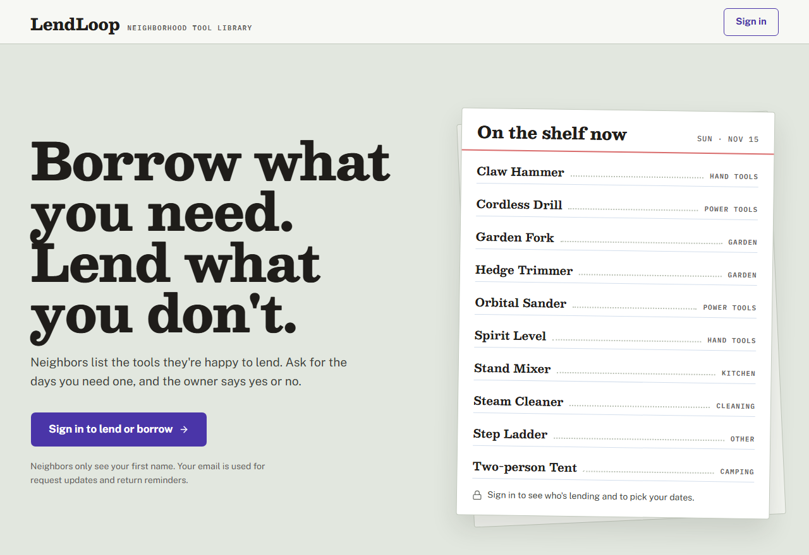
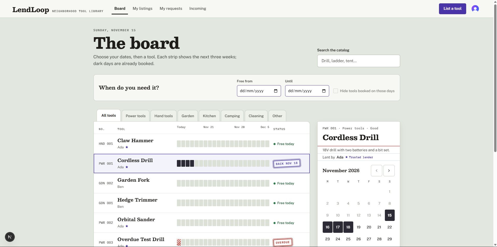
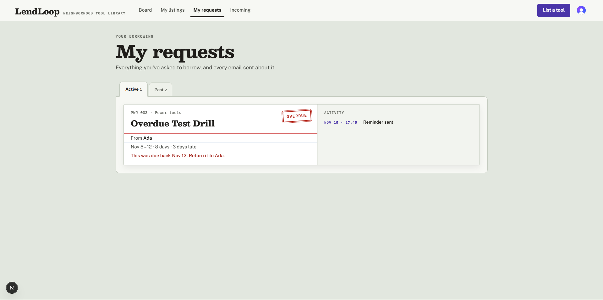
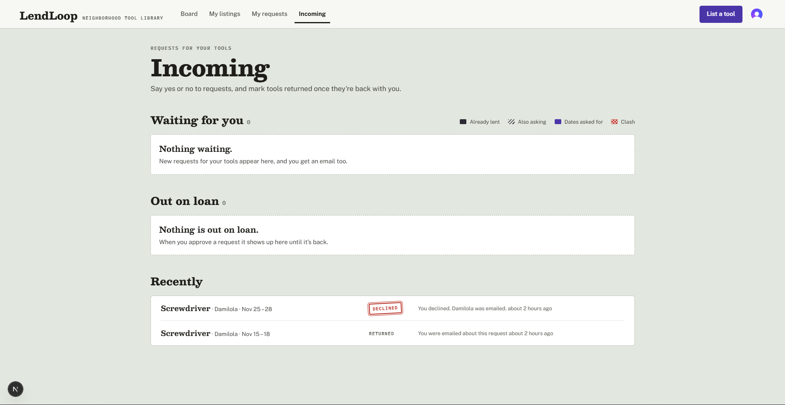
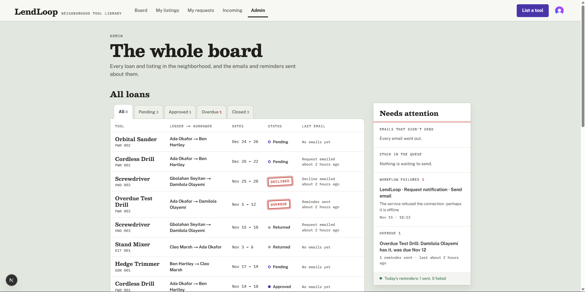
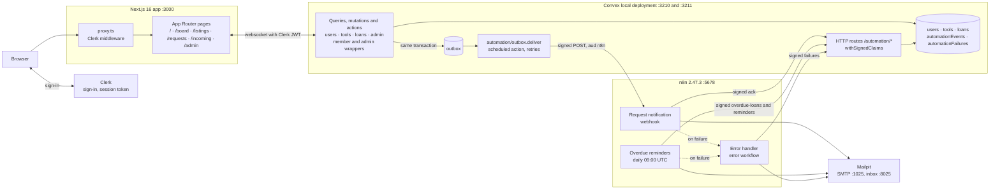
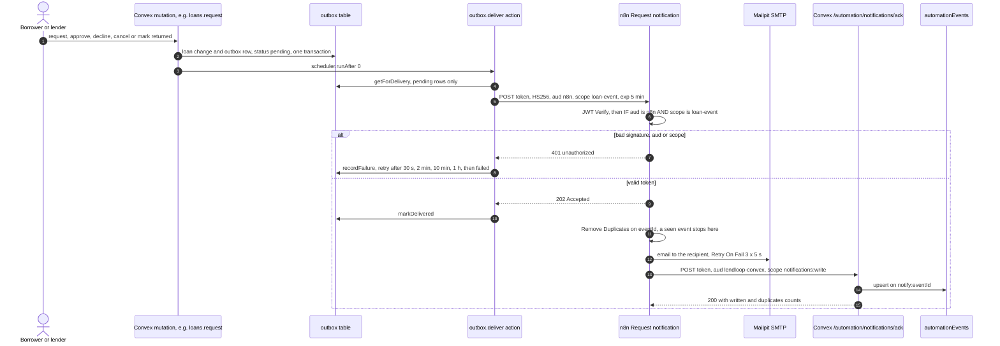
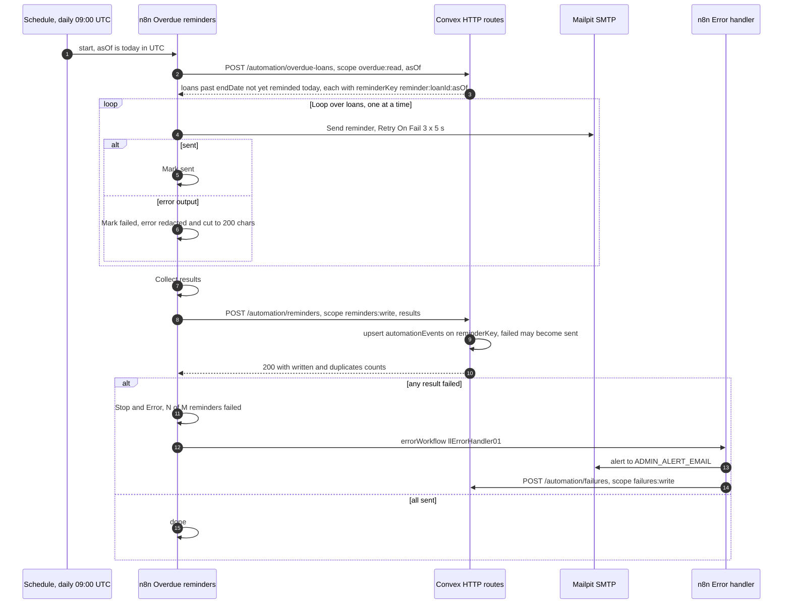

# LendLoop

**Borrow what you need. Lend what you don't.**

**Live demo: <https://lendloop-eight-flame.vercel.app>.** It runs from the [`hosted-demo`](https://github.com/theactualdev/lendloop/tree/hosted-demo) branch, which sends email straight from Convex through Brevo because there is no free, always-on host for n8n. This branch, `main`, is the n8n implementation described below.

LendLoop is a neighborhood tool-lending board. Neighbors list the tools they are willing to lend, ask to borrow each other's tools for a date range, and approve or decline the requests they receive. n8n handles the automation: an email when a request is created or changes status, and a daily reminder for overdue loans. Both directions are signed, retried and idempotent.

Stack: Next.js 16 (App Router), Clerk, Convex, n8n, TypeScript, Tailwind v4 and shadcn/ui. Everything runs natively on one machine: no Docker and no Convex account.

- [What it does](#what-it-does) · [Local setup](#local-setup) · [Environment variables](#environment-variables) · [Architecture](#architecture)
- [RBAC matrix](#rbac-matrix) · [Security decisions](#security-decisions) · [Data minimization](#data-minimization) · [Reliability](#reliability)
- [Requirements traceability](#requirements-traceability) · [Known limitations](#known-limitations) · [Production note](docs/PRODUCTION.md)

## Screenshots

The signed-out landing page (`/`, 1280px wide):



The signed-in screens below were captured during the end-to-end verification on 2026-11-15 with three test accounts (a lender, a borrower and the admin). Demo neighbors come from `seed:demo`.

**Board** (`/board`): each tool's three-week availability strip, the lender's first name with a trusted-lender star, and the request card for the selected tool.



**My requests** (`/requests`): the borrower's loans, with a status stamp, the next step and an activity slip of every email.



**Incoming** (`/incoming`): the lender's waiting requests, tools out on loan, and recent loans with their email activity.



**Admin** (`/admin`): every loan with lender and borrower names (never emails), plus Needs attention: failed or stuck deliveries, workflow failures, overdue loans and today's reminders.



## What it does

| Screen | Who | What |
|---|---|---|
| `/` | everyone | The tagline, a live "On the shelf now" list (tool name and category only, no owner details) and "Sign in to lend or borrow" (Clerk modal). |
| `/privacy` | everyone | A short, plain-language privacy page: this is a demo, what is stored, how long sent-email details are kept, no tracking, how to get your data deleted and which services are involved. Linked from the landing page and the member footer. |
| `/board` | signed in | Every tool with a 21-day availability strip, category tabs, search, a date picker and a request card. It shows the owner's first name and the Trusted Lender star. |
| `/listings` | signed in | My listings: create, edit and remove your own tools. Remove is blocked while a tool is out on loan. |
| `/requests` | signed in | My requests: your borrowing, with cancel on pending requests and on approved loans before pickup, the next step, and the email activity ("Reminder sent 2 days ago"). |
| `/incoming` | signed in | Incoming requests on your tools: approve or decline (a clash with an approved loan, or dates that are already over, blocks approval), and mark returned. |
| `/admin` | admins | All loans by tab, remove any listing with a reason, Trusted Lender switches, and "Needs attention": failed and stuck emails with Retry now, workflow failures and today's reminder count. |

n8n runs three workflows (`n8n/workflows/`):

- **LendLoop · Request notification** (`llRequestNotif01`): a webhook that receives signed loan events from Convex, emails the right person, and acknowledges back to Convex.
- **LendLoop · Overdue reminders** (`llOverdueRemind1`): runs daily at 09:00 UTC, fetches overdue loans from Convex, emails each borrower, and writes the result of each reminder back.
- **LendLoop · Error handler** (`llErrorHandler01`): the error workflow of the other two. It emails the admin and records the failure in Convex.

Emails go to Mailpit, a local SMTP server with a web inbox, so nothing leaves the machine.

## Prerequisites

- **Windows 10 or 11.** The project was built and tested natively on Windows. `npm run dev:all` starts `.tools\mailpit\mailpit.exe`, so on macOS or Linux, change that path in `package.json`.
- **Git Bash** (comes with Git for Windows). The commands below are Bash.
- **Node 24 LTS** on your `PATH`. The repo pins `24` in `.node-version`. With fnm: `fnm install 24`, then `fnm use 24`. Check with `node --version`.
- **n8n 2.47.3**, installed globally under that Node: `npm install -g n8n@2.47.3`. npm installs of n8n are deprecated from n8n 3.0; see [docs/PRODUCTION.md](docs/PRODUCTION.md).
- **Mailpit 1.33.1**: download the Windows amd64 zip from the [v1.33.1 release](https://github.com/axllent/mailpit/releases/tag/v1.33.1) and extract `mailpit.exe` to `.tools/mailpit/mailpit.exe`. `.tools/` is git-ignored.
- **A Clerk account**. The free development instance is enough.
- No Docker and no Convex account. Convex runs as an anonymous local deployment inside `npx convex dev`, with its data in `.convex/` (git-ignored).

## Local setup

Run every command from the repo root.

### 1. Install dependencies

```bash
npm install
```

### 2. Create the three env files

```bash
cp .env.example .env.local
cp .env.n8n.example .env.n8n
cp .env.secrets.example .env.secrets
```

All three are git-ignored; only the `*.example` templates are tracked. Three values are random. Generate each one with:

```bash
node -e "console.log(require('crypto').randomBytes(32).toString('base64'))"
```

Run it once per value, and paste each result after the `=`:

- `.env.n8n`: `N8N_ENCRYPTION_KEY`. Never change it after n8n's first start, or n8n cannot decrypt its stored credentials.
- `.env.secrets`: `LENDLOOP_TO_N8N_SECRET` and `N8N_TO_LENDLOOP_SECRET`. Use two different values. Each is used as raw text on both sides, never base64-decoded.

The other `.env.n8n` values already hold working local defaults. `.env.local` gets the Clerk keys in step 3, and `npx convex dev` fills in its Convex lines in step 4. [Environment variables](#environment-variables) lists every value.

### 3. Set up Clerk

1. In the [Clerk dashboard](https://dashboard.clerk.com), create an application. Keep email address as a sign-in identifier (the default). Then, under **User & authentication → Personal information**, enable **First and last name** and make them required, so neighbors see real first names. Accounts that have no name (for example ones created before you turned this on) see an in-app nudge to add one, and other people see them as "a neighbor" until they do.
2. Open **Integrations → Convex** and activate it. It shows your **Frontend API URL**, `https://<your-instance>.clerk.accounts.dev`. That URL is the issuer you set in step 5.
3. Open **Configure → Sessions → Customize session token** and add these claims, then save:

   ```json
   {
     "email": "{{user.primary_email_address}}",
     "name": "{{user.full_name}}",
     "given_name": "{{user.first_name}}"
   }
   ```

   Clerk's default session token carries no email or name, and the Convex integration uses that session token. Convex needs the email for notifications and the admin bootstrap; only first names are shown to other members. This is a one-time setting per Clerk instance, so a production instance needs it too. If you sign in before saving it, sign out and back in afterwards (or wait about a minute for Clerk's cached token to expire). If your Clerk profile has no first or last name, the app shows them to others as "a neighbor" and nudges them to add one; they can set it under the account menu → Manage account → Profile, and the app saves it to LendLoop right away (a direct update of your own name), with no sign-out.
4. Open **API keys** and copy the publishable key and the secret key into `.env.local`, as `NEXT_PUBLIC_CLERK_PUBLISHABLE_KEY` and `CLERK_SECRET_KEY`. Copy the secret key with its **copy button**. The dashboard displays it shortened (`sk_test_x…yyyy`), and selecting that text copies the shortened version, which breaks sign-in.

### 4. Start the stack

```bash
npm run dev:all
```

This runs four processes with `concurrently`: `next dev`, `convex dev`, `n8n start` (with `.env.n8n`) and Mailpit. Leave it running and use a second terminal for the rest.

**Before a demo, start it about five minutes early.** n8n is the slowest to come up, and slower still while `convex dev` typechecks and `next dev` compiles. Wait for `Editor is now accessible via` in the n8n output. Then make one borrow request and check that its email reaches Mailpit (<http://127.0.0.1:8025>). Until n8n has registered its webhooks, Convex's deliveries get a 404 and wait for the outbox's next retry (30 s, then 2 min, then 10 min), so an email sent too early arrives minutes late. To show the overdue reminders on demand, open the workflow in the n8n editor and click **Execute workflow** instead of waiting for 09:00 UTC.

On the first run, `convex dev` downloads the Convex local backend and creates an anonymous local deployment in `.convex/`, without asking for an account. It writes `CONVEX_DEPLOYMENT`, `NEXT_PUBLIC_CONVEX_URL` and `NEXT_PUBLIC_CONVEX_SITE_URL` into `.env.local`, then stops with `Environment variable CLERK_JWT_ISSUER_DOMAIN is used in auth config file but its value was not set`. That is expected: step 5 sets it, and `convex dev` retries by itself. If `convex dev` ever asks a question instead, stop `dev:all`, run `npx convex dev --once` in a normal terminal, choose **Start without an account (run Convex locally)**, then start `dev:all` again.

Once n8n is up, open <http://127.0.0.1:5678> and create the n8n owner account right away (it is local only; no n8n cloud account is involved). Until an owner exists, whoever reaches the editor first can claim it, and the owner can use the stored credentials, including both signing keys, and edit Code nodes that read n8n's env. `N8N_LISTEN_ADDRESS=127.0.0.1` already keeps other machines out; the owner account keeps out other programs and users on this machine.

### 5. Set the Convex environment variables

```bash
npx convex env set CLERK_JWT_ISSUER_DOMAIN https://<your-instance>.clerk.accounts.dev
npx convex env set N8N_REQUEST_WEBHOOK_URL http://127.0.0.1:5678/webhook/lendloop/loan-events
npx convex env set --from-file .env.secrets
```

`--from-file` reads both signing secrets from `.env.secrets` and prints only a count ("Successfully set 2 environment variables…"), so the values never reach your terminal or shell history. Running it again is a no-op when nothing changed; to change a secret later, add `--force`. The `convex dev` window should now show `Convex functions ready!`.

### 6. Sign in and make yourself admin

Open <http://localhost:3000>, sign in with "Sign in to lend or borrow", then click "Go to the board". The first load of a member page creates your user row (`users.ensureUser`). Then grant yourself the admin role, using your Clerk account's email:

```bash
npx convex run users:setRole '{"email":"you@example.com","role":"admin"}'
```

`setRole` is an internal mutation: only the Convex CLI, which holds the deployment's admin key, can run it. The Admin link appears in the header right away.

### 7. Create the n8n credentials

```bash
npm run n8n:credentials
```

`scripts/n8n-credentials.mjs` creates the three credentials the workflows reference by fixed id:

| Credential | Id | Type | Value |
|---|---|---|---|
| LendLoop → n8n | `lendloopToN8n01` | JWT, passphrase, HS256 | `LENDLOOP_TO_N8N_SECRET` |
| n8n → LendLoop | `n8nToLendloop01` | JWT, passphrase, HS256 | `N8N_TO_LENDLOOP_SECRET` |
| Mailpit | `mailpitSmtp00001` | SMTP | `127.0.0.1:1025`, no TLS, no auth |

It reads `.env.secrets`, writes a temp file in the OS temp folder (outside the repo), runs `n8n import:credentials`, and deletes the file in a `finally`, and also when you press Ctrl+C or the script gets SIGTERM. It never prints a value. Running it again updates the same three credentials in place.

### 8. Import the workflows

```bash
npm run n8n:import
```

### 9. Publish the workflows

```bash
npx dotenv -e .env.n8n -- n8n publish:workflow --id=llErrorHandler01
npx dotenv -e .env.n8n -- n8n publish:workflow --id=llRequestNotif01
npx dotenv -e .env.n8n -- n8n publish:workflow --id=llOverdueRemind1
```

Publish the error handler first, because the other two point to it. The running n8n picks each one up about 15 seconds later. Every import deactivates a workflow, so publish again after any `n8n:import`.

### 10. Load demo data

```bash
npx convex run seed:demo
```

This adds four neighbors (Ada, Ben, Cleo and Dev, with `@example.test` emails; Ada is a Trusted Lender), ten tools across the categories, and three loans: one out now, one pending and one returned. Seeded rows are inserted directly, so they send no emails. The command is idempotent.

### Try it

| URL | What |
|---|---|
| <http://localhost:3000> | The app |
| <http://127.0.0.1:8025> | Mailpit, the inbox for every email (the demo neighbors, you and the admin alerts) |
| <http://127.0.0.1:5678> | n8n |
| `npx convex dashboard` | The Convex dashboard for the local deployment (data, logs, functions) |

- **Borrow:** on the board, pick dates on one of Ada's tools and send a request. Ada's email lands in Mailpit within seconds, and your request on `/requests` shows "Ada was emailed your request".
- **Act as a demo neighbor:** the demo users cannot sign in, but the CLI can act as them. For example, Ada approves your request (the loan id is in the Convex dashboard's `loans` table):

  ```bash
  npx convex run loans:approve '{"loanId":"<loan id>"}' --identity '{"issuer":"demo","subject":"ada"}'
  ```

- **Both sides:** for a full lender and borrower flow, sign in with a second Clerk account in another browser.
- **Overdue reminder, by hand:** create an overdue loan, then run the workflow from the CLI. n8n is already running, so the CLI needs its own task-broker port:

  ```bash
  npx convex run seed:overdueLoan
  N8N_RUNNERS_BROKER_PORT=5690 npx dotenv -e .env.n8n -- n8n execute --id=llOverdueRemind1
  ```

  Mailpit gets a "Reminder: please return the Overdue Test Drill" email, and on `/admin` the loan's last email reads "Reminder sent" and Needs attention counts it in today's reminders. Run it again the same day and nobody is emailed twice. A CLI run does not trigger the error workflow; the scheduled run does.
- **n8n editor:** open <http://127.0.0.1:5678> and sign in with the owner account from step 4. The imported workflows and credentials show up under Workflows and Credentials.

### Tests and checks

```bash
npm test               # Vitest: Convex functions (convex-test), signing, HTTP routes, outbox, UI helpers
npm run typecheck
npm run lint
npm run check:secrets  # scans n8n/workflows/*.json for secrets; exits 1 on any hit
npm run build
npm run check:seo      # after npm run start: fetches the public pages as Googlebot; exits 1 on a redirect, noindex, wrong canonical or missing robots.txt, sitemap or preview image
```

`npm run check:seo -- https://<your-app>.vercel.app` runs the same check against a deployment.

After changing a workflow in the n8n editor, stop n8n, run `npm run n8n:export` (it exports only the `LendLoop · ` workflows, by id, in about two minutes, and writes each as one normalized workflow object: no timestamps, project ids or version counters, so diffs stay small), then `npm run check:secrets`. [n8n/README.md](n8n/README.md) has the n8n conventions, the drill log and the runbook.

### Troubleshooting

| Symptom | Fix |
|---|---|
| `node`, `npx` or `n8n` not found, or the wrong Node version | Node 24 must be on `PATH` in every terminal (`fnm use 24`; `node --version` prints `v24.…`). n8n is installed under that Node. |
| An n8n CLI command takes minutes | The n8n CLI is slow, especially while n8n is running: `import`, `publish` and `export` can take one to several minutes each. Wait for it. |
| The n8n webhook answers 404 | n8n needs a few minutes after `n8n start` to register webhooks, plus about 15 s after each publish. Emails queued meanwhile are retried by the outbox (30 s, 2 min, 10 min, 1 h). After that, use Retry now on `/admin`. |
| "We couldn't connect your account" | The Clerk Convex integration is off (Clerk dashboard → Integrations → Convex), or `CLERK_JWT_ISSUER_DOMAIN` doesn't match your Frontend API URL. |
| "We couldn't set up your account", or `identity has no email claim` in the logs | The session token has no email. Add the `email`, `name` and `given_name` claims under Configure → Sessions → Customize session token (step 3), then sign out and back in after saving. |
| `Clerk: unable to resolve handshake … Cannot convert argument to a ByteString because the character at index 16 has a value of 8230`, or you stay on the landing page after signing in (clicking "Sign in" then says you are already signed in) | `CLERK_SECRET_KEY` is the shortened display (`sk_test_x…yyyy`; character 8230 is "…"). Copy the full key with the dashboard's copy button, update `.env.local` and restart `next dev`. |
| `Environment variable CLERK_JWT_ISSUER_DOMAIN is used in auth config file but its value was not set` | Run step 5. |
| `Task Broker's port 5679 is already in use` from `n8n execute` | Prefix the command with `N8N_RUNNERS_BROKER_PORT=5690`, as shown above. |
| `convex dev` exits with `EEXIST: file already exists, open '…\convex\dashboard\out\404.html'` | The CLI is unpacking a newer local dashboard over an old copy (it happens after it upgrades the local backend). Rename or delete `%LOCALAPPDATA%\convex\dashboard` and start `dev:all` again; `convex dev` downloads a fresh copy. |
| `Could not find project with name anonymous-…` right after you deleted `.convex/` | Harmless. `convex dev` reconfigures a fresh local deployment and rewrites `CONVEX_DEPLOYMENT` itself. |
| n8n warns `Failed to start Python task runner … virtual environment is missing` | A warning, harmless. No LendLoop workflow uses Python. |
| No email in Mailpit | Check that Mailpit runs (<http://127.0.0.1:8025>) and that the three workflows are published. `/admin` → Needs attention shows failed and stuck deliveries and workflow failures. |

## Environment variables

| Name | Where it lives | Purpose | How to get or generate it |
|---|---|---|---|
| `NEXT_PUBLIC_CLERK_PUBLISHABLE_KEY` | `.env.local` | Clerk's browser key | Clerk dashboard → API keys |
| `CLERK_SECRET_KEY` | `.env.local` | Clerk's server key (`proxy.ts`, which runs on the member routes only; public pages read the session in the browser) | Clerk dashboard → API keys |
| `CONVEX_DEPLOYMENT` | `.env.local` | The deployment that `npx convex` commands target | Written by `npx convex dev` on its first run |
| `NEXT_PUBLIC_CONVEX_URL` | `.env.local` | Convex API and websocket, `http://127.0.0.1:3210` | Written by `npx convex dev` |
| `NEXT_PUBLIC_CONVEX_SITE_URL` | `.env.local` | Convex HTTP actions, `http://127.0.0.1:3211` (for reference; the app doesn't read it) | Written by `npx convex dev` |
| `CLERK_JWT_ISSUER_DOMAIN` | Convex env (listed in `.env.example` for reference) | The issuer `convex/auth.config.ts` trusts | Clerk Frontend API URL; `npx convex env set` |
| `N8N_REQUEST_WEBHOOK_URL` | Convex env | Where the outbox posts loan events | `http://127.0.0.1:5678/webhook/lendloop/loan-events`; `npx convex env set` |
| `LENDLOOP_TO_N8N_SECRET` | `.env.secrets` → Convex env and n8n credential "LendLoop → n8n" | HS256 key for Convex → n8n tokens | 32 random bytes, base64 (step 2); `npx convex env set --from-file` and `npm run n8n:credentials` |
| `N8N_TO_LENDLOOP_SECRET` | `.env.secrets` → Convex env and n8n credential "n8n → LendLoop" | HS256 key for n8n → Convex tokens | Same as above |
| `N8N_USER_FOLDER` | `.env.n8n` | n8n's data folder: the SQLite database and encrypted credentials end up in `.n8n/` (git-ignored) | `./.n8n` |
| `N8N_LISTEN_ADDRESS` | `.env.n8n` | Binds n8n to this machine only, so nobody else on the network can reach the editor or the webhooks (n8n's default listens on every interface) | `127.0.0.1` |
| `N8N_ENCRYPTION_KEY` | `.env.n8n` | Encrypts the credentials in n8n's database. Never change it after the first start | 32 random bytes, base64 (step 2) |
| `NEXT_PUBLIC_CLERK_TELEMETRY_DISABLED` | `.env.local` | Optional. `next.config.ts` `env` already inlines `1` at build time, which turns off Clerk's usage telemetry in the server code (the browser side is `telemetry={false}` in `app/layout.tsx`); the privacy page promises it is off | `1` |
| `CSP_EXTRA_CLERK_HOSTS` | `.env.local` (optional) | Space-separated extra hosts the Content-Security-Policy should allow for Clerk, for a custom domain that the publishable key does not already name | Leave unset unless the console shows a CSP violation for a Clerk host |
| `GOOGLE_SITE_VERIFICATION` | Deployment env (optional) | Adds Google Search Console's verification tag to every page. Read at build time, so redeploy after setting it | Search Console → add a URL-prefix property → HTML tag → copy the tag's `content` value |
| `ADMIN_ALERT_EMAIL` | `.env.n8n` | Recipient of the error handler's alerts | Any address; Mailpit catches all of them. Default `admin@example.test` |
| `GENERIC_TIMEZONE` | `.env.n8n` | Time zone of n8n schedules | `UTC` |
| `LENDLOOP_CONVEX_SITE_URL` | `.env.n8n` | Base URL of the Convex HTTP routes n8n calls | `http://127.0.0.1:3211` |
| `APP_URL` | `.env.n8n` | Links in the emails | `http://localhost:3000` |
| `N8N_BLOCK_ENV_ACCESS_IN_NODE` | `.env.n8n` | Lets workflows read their config from `$env` (`LENDLOOP_CONVEX_SITE_URL`, `APP_URL`, `ADMIN_ALERT_EMAIL`). It is not limited to those: any expression or Code node can then read all of n8n's env, including `N8N_ENCRYPTION_KEY`. That is acceptable here because n8n listens on `127.0.0.1` only and has an owner account (step 4), so only you can write workflows; the signing secrets are never in n8n's env. Production should block it (docs/PRODUCTION.md) | `false` |
| `EXECUTIONS_DATA_PRUNE` | `.env.n8n` | Prune old execution data, which holds recipient addresses | `true` |
| `EXECUTIONS_DATA_MAX_AGE` | `.env.n8n` | Hours of execution data to keep | `168` (7 days) |

`.env.secrets` is read by no running process: only `npx convex env set --from-file`, `npm run n8n:credentials` and `npm run check:secrets` (which looks for its values in the workflow JSON) read it. The signing secrets are therefore never in the Next.js server env or in n8n's process env; n8n holds them only as encrypted credentials.

## Architecture

Convex is the system of record and the only place rules are enforced: RBAC, the loan state machine and idempotent write-backs. A loan mutation writes an outbox row in the same transaction. A scheduled Convex action delivers it to n8n as an HS256-signed token and retries with backoff. n8n delivers to people over SMTP (Mailpit locally) and calls back into Convex HTTP routes, also signed, to fetch overdue loans and record outcomes. A local Convex deployment can reach `127.0.0.1:5678`, which is why everything runs natively with no tunnel (Convex Cloud could not reach a laptop).

### Components



### Notification flow



### Overdue flow



With no overdue loans the run ends after the fetch, with no write-back.

### Code layout

| Path | What |
|---|---|
| `convex/schema.ts` | Tables: `users`, `tools`, `loans`, `outbox`, `automationEvents`, `automationFailures` |
| `convex/users.ts`, `tools.ts`, `loans.ts`, `admin.ts` | Public functions, one file per domain |
| `convex/lib/` | Pure rules and helpers: `auth.ts` (wrappers), `loanRules.ts` (state machine, date rules), `availability.ts`, `loanQueries.ts` (`holdingLoans`), `loanView.ts`, `constants.ts` (categories and field limits, shared with the client), `text.ts` (name cleaning, shared with the client), `signing.ts`, `signedRoute.ts`, `redact.ts`, `shortCode.ts`, `toolLifecycle.ts`, `errors.ts` |
| `convex/retention.ts`, `convex/lib/rateLimits.ts` | The nightly retention job (R34-4); the per-member rate limits |
| `convex/automation/` | `payload.ts` (allowlist), `outbox.ts` (enqueue, deliver, retries), `endpoints.ts` (internal functions behind the HTTP routes) |
| `convex/http.ts` | The four signed `/automation/*` routes |
| `convex/seed.ts` | `seed:demo` and `seed:overdueLoan` (internal) |
| `app/`, `components/`, `lib/` | Next.js routes, UI components and pure UI helpers (tested) |
| `proxy.ts` | Clerk middleware protecting the member routes |
| `n8n/workflows/` | The three exported workflows; `n8n/README.md` has conventions, drills and the runbook |
| `scripts/` | `n8n-credentials.mjs`, `n8n-export.mjs`, `check-workflows.mjs` |
| `docs/` | `decisions.md` (design decisions), `verification.md` (what was checked, what is owed), `PRODUCTION.md` |

## Deleting a member's data on request

The /privacy page promises this. There is no delete button; the admin does it from the command line.

1. Delete the user in the Clerk dashboard first, so they cannot sign back in and get a fresh row.
2. Run `npx convex run users:deleteMember '{"email":"<their email>"}'` (add `--prod` for a cloud deployment), or run it from the dashboard's Functions page. It is an internal mutation (not callable from the app) that deletes the user row, their tools, every loan on those tools or that they borrowed, and those loans' outbox rows and activity events. It returns the counts, and fails with `NOT_FOUND` for an unknown email or `INVALID_INPUT` if any set is over 500 rows (nothing is deleted then). Tested in `convex/users.test.ts`.
3. Loans they had with other members disappear from those members' history too. `automationFailures` hold no member data and are pruned at 180 days. n8n execution data is pruned after 7 days.

## RBAC matrix

The role lives in `users.role` in Convex, not in a JWT claim, so a change takes effect on the next call. Every public Convex function except `tools.listPublic`, `users.ensureUser` and `users.viewer` goes through a wrapper in `convex/lib/auth.ts`: `memberQuery` and `memberMutation` load the caller's user row (`UNAUTHENTICATED` without one), and `adminQuery` and `adminMutation` also require `role === "admin"` (`FORBIDDEN`). Ownership and party checks sit inside the function. The UI only hides what Convex would refuse anyway.

"Not involved" is a signed-in user with no part in the tool or loan. "Admin" means an admin acting on someone else's tool or loan; on their own tools and loans an admin is an owner or party like anyone else.

| Action | Anonymous | User, not involved | Owner or party | Admin | Enforced by | Proven by |
|---|---|---|---|---|---|---|
| Browse the public shelf (name, category) | Yes | Yes | Yes | Yes | `tools.listPublic`: plain `query` with a fixed projection | tools.test: "listPublic returns objects with exactly the keys ['category','name']" |
| Open a member page | No: redirect to sign-in | Yes | Yes | Yes | `proxy.ts` (`auth.protect()`) | `proxy.test.ts`; `307` checks in `docs/verification.md` |
| Create own user row | No (`UNAUTHENTICATED`) | Yes, always role `user` | n/a | n/a | `users.ensureUser` | users.test: "ensureUser creates role 'user' even if identity carries a role claim" |
| Browse the board, filter by category | No (`UNAUTHENTICATED`) | Yes | Yes | Yes | `tools.list` (`memberQuery`) | users.test: "memberQuery throws UNAUTHENTICATED when signed out"; tools.test: "list filters by category and marks isMine" |
| See pending requests in a tool's strip | No | No | Owner: all; borrower: own only | As a user | `tools.list` (`buildCards`) | tools.test: "list hides other people's pending requests from bookings" |
| List my tools | No | Own only | Own | Own only | `tools.myListings`: `by_owner` index on the caller | By construction |
| Create a tool | No | Yes, as its owner | n/a | Yes, as its owner | `tools.create` (`memberMutation`, `ownerId` is the caller) | tools.test: "create assigns the next shortCode for the category" |
| Edit a tool | No | No (`FORBIDDEN`) | Owner: yes | No (`FORBIDDEN`) | `tools.update` → `ownedActiveTool` | tools.test: "update by non-owner throws FORBIDDEN" |
| Remove own tool (soft delete) | No | No (`FORBIDDEN`) | Owner: yes, but not during a loan (`TOOL_ON_LOAN`) | Uses "Remove any listing" | `tools.remove` → `ownedActiveTool` | tools.test: "remove soft-deletes and sets pending requests to declined", "remove throws TOOL_ON_LOAN while an approved loan is unreturned" |
| Request to borrow | No | Yes | Owner: no (`OWN_TOOL`); a repeat ask: `ALREADY_REQUESTED` | Yes, as a borrower | `loans.request` | loans.test: "request on own tool → OWN_TOOL", "a second identical request → ALREADY_REQUESTED, with no second loan or email" |
| Approve or decline | No | No (`FORBIDDEN`) | Lender: yes, but not approve once the dates are over (`REQUEST_EXPIRED`); borrower: no (`FORBIDDEN`) | No (`FORBIDDEN`) | `loans.approve`, `loans.decline` → `actorFor` + `nextStatus` | loans.test: "borrower cannot approve own request → FORBIDDEN", "unrelated user cannot decline → FORBIDDEN"; loanRules.test: all 90 status × action × actor triples |
| Cancel a request or an approved loan | No | No (`FORBIDDEN`) | Borrower: yes on a pending request, and on an approved loan until its start date (`LOAN_STARTED` from then on); lender: no (`FORBIDDEN`) | No (`FORBIDDEN`) | `loans.cancel` → `nextStatus` + start-date check | loans.test: "lender approves and declines; borrower cancels; timestamps set", "the borrower cancels before the start date: cancelled, and the lender is emailed", "the borrower cannot cancel on the start date or later → LOAN_STARTED"; loanRules.test |
| Withdraw approval | No | No (`FORBIDDEN`) | Lender: yes, only before the start date (`LOAN_STARTED` from then on); borrower: no (`FORBIDDEN`) | Yes | `loans.withdrawApproval` → `nextStatus` + start-date check | loans.test: "the lender withdraws before the start date: cancelled, and the borrower is emailed", "an admin may withdraw too", "an unrelated user can neither cancel nor withdraw → FORBIDDEN"; loanRules.test |
| Mark returned | No | No (`FORBIDDEN`) | Lender: yes; borrower: no | Yes | `loans.markReturned` → `nextStatus` | loans.test: "admin may mark returned"; loanRules.test |
| View my requests and incoming requests | No | Own only | Own | Own only | `loans.myRequests` (`by_borrower`), `loans.incoming` (`by_lender`) | loans.test: "incoming lists only loans on viewer tools; myRequests only viewer borrowing" |
| Remove any listing | No | No (`FORBIDDEN`) | No (`FORBIDDEN`) | Yes, with an optional reason up to 280 chars | `admin.removeListing` (`adminMutation`) | admin.test: "removeListing by role 'user' → FORBIDDEN", "admin removes another user's listing; its pending requests become declined" |
| View all loans | No | No (`FORBIDDEN`) | No (`FORBIDDEN`) | Yes | `admin.allLoans` (`adminQuery`) | admin.test: "allLoans → FORBIDDEN for user; returns every loan for admin" |
| Mark a Trusted Lender | No | No (`FORBIDDEN`) | No (`FORBIDDEN`) | Yes | `admin.setTrustedLender` (`adminMutation`) | admin.test: "setTrustedLender is reflected in tools.list ownerTrusted" (also asserts `FORBIDDEN` for a user) |
| See lenders and automation health | No | No (`FORBIDDEN`) | No (`FORBIDDEN`) | Yes | `admin.lenders`, `admin.automationHealth` (`adminQuery`) | admin.test: "lenders is admin-only and returns timesLent", "automationHealth is admin-only and returns failed rows newest first" |
| Retry a failed or stuck email delivery | No | No (`FORBIDDEN`) | No (`FORBIDDEN`) | Yes | `admin.retryDelivery` (`adminMutation`) | outbox.test: "retryDelivery is admin-only and re-queues a failed row", "retryDelivery re-queues a pending row stuck over 2 hours, but not a fresh pending or delivered row" |
| Grant or revoke admin | No | No | No | No: no client can call it | `users.setRole` is an `internalMutation`, run with `npx convex run` | users.test: "setRole is internal: api.users has no setRole" |
| Call the `/automation/*` HTTP routes | `401` | `401` | n/a | `401` | Only a token signed with `N8N_TO_LENDLOOP_SECRET`, `aud` `lendloop-convex` and the route's scope (`withSignedClaims`) | http.test: "401 for missing, wrong-secret, expired, and wrong-scope tokens", "wrong audience and cross-route scope are 401" |

Two details of an admin removal: it does not wait for an active loan to end (that loan stays approved), and, like an owner's removal, it declines every pending request on the tool and notifies those borrowers.

## Security decisions

- **Signed in both directions, with JWS.** Every Convex ↔ n8n message is a compact JWS (HS256, which is HMAC-SHA256) whose claims are the payload (`convex/lib/signing.ts`, `jose`). n8n signs and verifies with its built-in JWT node and JWT credentials, so no secret sits in a Code node or in workflow JSON, and there is no raw-body canonicalization to get wrong. The token travels in the JSON body as `{ "token": "…" }`.
- **Pinned algorithm and required claims.** The verifier allows only `HS256` (`alg: none` and `HS512` are rejected in tests) and requires `aud`, `exp`, `iat` and a string `jti`. Tokens live 5 minutes (`exp` = `iat` + 300 s). `maxTokenAge: "5m"` with a 30 s clock tolerance rejects an old token even if its `exp` is far in the future.
- **Scopes per route.** Convex → n8n uses scope `loan-event`. n8n → Convex uses `overdue:read`, `reminders:write`, `notifications:write` and `failures:write`, and each route checks its own (`withSignedClaims`), so a token for one route is a `401` on another. n8n's JWT Verify does not check `aud`, so an IF node right after it requires `aud == "n8n"` and the scope, and anything else gets the same `401`.
- **Separate secrets and audiences per direction.** `LENDLOOP_TO_N8N_SECRET` with audience `n8n`, and `N8N_TO_LENDLOOP_SECRET` with audience `lendloop-convex`. A leaked secret lets an attacker forge only one direction.
- **Opaque 401s.** Every verification failure returns the same `401 {"error":"unauthorized"}`. `InvalidTokenError` carries a fixed message and keeps the jose error only as its `cause`. Claim-shape problems get `400 {"error":"bad_request"}`, and only after the signature checks out. An unexpected throw gives `500 {"error":"internal"}` with no message. `outbox.deliver` records only an error's name and message, never the token, secret or payload.
- **Replays.** There is no `jti` store. A replay inside the 5-minute window changes nothing, because every n8n → Convex write is an idempotent upsert, and n8n drops a repeated `eventId` (see [Reliability](#reliability)).
- **Security headers and CSP (R34-5).** `next.config.ts` sends, on every route, `X-Content-Type-Options: nosniff`, `Referrer-Policy: strict-origin-when-cross-origin`, `Permissions-Policy: camera=(), microphone=(), geolocation=()`, `X-Frame-Options: DENY`, a Content-Security-Policy, and in production only `Strict-Transport-Security: max-age=63072000; includeSubDomains`. The policy is built in `lib/security-headers.ts` (unit-tested) from the environment: `default-src 'self'`; scripts from the app, Clerk (`*.clerk.accounts.dev` plus the instance host decoded from `NEXT_PUBLIC_CLERK_PUBLISHABLE_KEY`, which covers a custom Clerk domain) and Cloudflare Turnstile; connections to the same hosts and the Convex deployment (`NEXT_PUBLIC_CONVEX_URL` over http and ws, plus `*.convex.cloud`); images from the app, `img.clerk.com` and `data:`; workers from `self` and `blob:`; frames only from Turnstile and Clerk; `frame-ancestors 'none'`, `form-action 'self'`, `base-uri 'self'`, `object-src 'none'`. Scripts and styles keep `'unsafe-inline'` because Next's bootstrap scripts are inline and a nonce would make every page dynamic, which Cache Components avoids. `'unsafe-eval'` and local websockets are added in development only.
- **Rate limits.** `@convex-dev/rate-limiter` (registered in `convex/convex.config.ts`, defined in `convex/lib/rateLimits.ts`) gives each member a token bucket per action: `loans.request` 10 an hour, `tools.create` 10 a day, `users.setMyName` 20 an hour. A refused call fails with `RATE_LIMITED` ("You're doing that a lot. Try again in a little while."). The check runs after authorization and input validation, in the same mutation as the write, so rejected input spends nothing and a throw rolls the spend back. Reads are not limited. Tested in `convex/rateLimits.test.ts`, which runs the real component under convex-test (`newTest` in `convex/test.setup.ts` registers it).
- **RBAC enforced in Convex**, as in the [RBAC matrix](#rbac-matrix). The role is a database field, not a token claim, and `ensureUser` ignores any role claim the identity carries.
- **Internal-only role mutation.** `users.setRole` is an `internalMutation`: it is not in the public API, and only someone holding the deployment's admin key (`npx convex run`) can grant admin.
- **Soft delete.** Tools are never hard-deleted: `status: "removed"` with `removedAt`, `removedBy` and an optional `removedReason`, so loan history stays intact for admins. Removing a tool declines its pending requests and notifies those borrowers, and an owner cannot remove a tool while it is out on loan.
- **Secrets never in code or workflow JSON.** `.env.*` files are git-ignored except the templates. The secrets go from `.env.secrets` into the Convex env (`--from-file`) and into encrypted n8n credentials (`npm run n8n:credentials`, via a temp file outside the repo that is deleted). Workflows reference credentials by name and id only. `npm run check:secrets` fails if an exported workflow contains a value from `.env.local`, `.env.n8n` or `.env.secrets`, `sk_test_`, `sk_live_` or `-----BEGIN`, a node parameter named `secret`, `password` or `passphrase`, non-empty `pinData`, or an email address other than `lendloop@localhost`. It prints file and variable names only.
- **n8n is local-only.** `N8N_LISTEN_ADDRESS=127.0.0.1` keeps n8n off the network, and the setup claims the owner account on the first start (step 4), because whoever owns n8n can use its credentials and, with `N8N_BLOCK_ENV_ACCESS_IN_NODE=false` (needed for the `$env` config), read its whole env from a Code node.
- **Email redaction in depth.** Error text can carry addresses (SMTP errors do). n8n redacts email-shaped text before truncating (to 500 chars in the error handler, 200 in the overdue workflow), and Convex redacts again (`redactEmails` in `convex/lib/redact.ts`) before storing a workflow failure or a failed reminder's detail. Loan activity shows a `detail` only for `notification_sent`, where it is an event type. Test: "a failed reminder's error never exposes an email through lender or admin views".
- **Protected routes.** `proxy.ts` sends signed-out visitors on `/board`, `/listings`, `/requests`, `/incoming` and `/admin` to sign-in. Its matcher regex has a regression test.

## Data minimization

- **Public projection.** `tools.listPublic` returns exactly `{name, category}`, and hides tools that are out on loan today: no owner, id or code. Tested, and the signed-out page HTML was grepped for owner names, emails and ids (0 matches, `docs/verification.md`).
- **Member views.** Tools show the owner's first name and the Trusted Lender flag. A booking in a strip carries only its dates and kind (booked or requested), never who booked it, and other people's pending requests are hidden. `LoanView` is built field by field (never by spreading a document) and shows the other party's first name only.
- **Payload allowlist, enforced by the schema.** The `notificationPayload` validator in `convex/automation/payload.ts` is the type of `outbox.payload`, so Convex itself rejects any extra field. The exact set is `eventId`, `type`, `loanId`, `recipient {email, firstName}`, `tool {name}`, `startDate`, `endDate`. The recipient's email is the only personal data that leaves Convex, because n8n needs it to send. A test compares the keys deeply.
- **Overdue feed.** Each item is `loanId`, `reminderKey`, `borrower {email, firstName}`, `toolName`, `endDate`, `daysOverdue`, with exact keys tested.
- **Emails.** First name, tool name, dates and a link to the app. No other party's address, and no lender identity in a reminder.
- **Admins see names, not emails.** `admin.allLoans` returns full names (the test asserts no email or `tokenIdentifier` in the result). `admin.automationHealth` returns outbox rows through a projection without the payload, because the payload holds the recipient's email.
- **n8n execution data is pruned** after 168 hours (`EXECUTIONS_DATA_PRUNE`, `EXECUTIONS_DATA_MAX_AGE`), since executions hold recipient addresses.
- **Error alerts carry no payload:** the workflow name, execution id, failed node, the redacted message and the execution URL.
- **Stored user data** is the Clerk `tokenIdentifier`, name and email, plus `role` and `trustedLender`. The public [/privacy](app/privacy/page.tsx) page tells members this in plain words.
- **Retention (R34-4).** A daily Convex cron (01:00 UTC, `crons.ts` → `retention.run`) tidies sent-email data in batches of 100, scheduling itself again while a batch is full. Delivered `outbox` rows older than 7 days have `payload.recipient.email` and `firstName` blanked to `""` and get `redactedAt` (the `by_status_redacted` index finds only unredacted rows, so a second run does nothing). Delivered rows older than 90 days are deleted, and so are `automationEvents` and `automationFailures` older than 180 days. `pending` and `failed` rows are never touched, because they still need their payload to be sent or retried. Ages count from `_creationTime`. Tested in `convex/retention.test.ts`: 8-day-old redacted and 6-day-old kept, pending and failed untouched, deletion at 90 and 180 days, a second run is a no-op, and a full batch reschedules.

## Reliability

- **Stale requests expire.** A daily Convex cron (00:30 UTC, `crons.ts` → `loans.expireStale`) closes pending requests whose end date has passed as `expired`, in batches of 100 using the `by_status_end` index. It sends no email and writes no outbox row. Tested in loans.test ("expireStale").
- **Transactional outbox.** A loan mutation, its outbox row and the scheduled `deliver` commit together, so if the mutation throws, nothing is queued (tested). `deliver` posts with a 10 s timeout. A non-2xx answer or a throw records the failure and retries after 30 s, 2 min, 10 min and 1 h; after the fifth failed attempt the row becomes `failed`. Admins see failed rows in Needs attention with Retry now (`admin.retryDelivery` resets the attempts and requeues), and the lender sees "Email didn't send. An admin can resend it." A row still pending 2 hours after it was queued (`queuedAt`, else its creation time) has lost its job, since the whole retry schedule ends after about 72 minutes. It shows under "Stuck in the queue" (`stalePending`) with Retry now too. A pending row younger than that, or a delivered one, cannot be retried (`INVALID_TRANSITION`). A delivered or failed row is never sent again by `deliver`.
- **Retries in n8n.** Every HTTP Request and Send Email node has Retry On Fail: 3 tries, 5 s apart. Both workflows name the error handler as their error workflow. The error handler has two independent channels, an email to the admin and a signed POST to `/automation/failures`, each set to continue on error, so one channel failing cannot block the other (drilled with Convex down, then with Mailpit down). An unknown event type stops with an error instead of vanishing. A reminder run with any failed send ends in Stop and Error ("N of M reminders failed") after the write-back, so partial failures alert too.
- **Idempotency keys.** Acks upsert on `notify:<eventId>`. Reminders upsert on `reminder:<loanId>:<asOf>`, where the only allowed change is failed → sent. Failure reports upsert on `executionId` (the `by_execution` index). Every write-back answers with `written` and `duplicates` counts.
- **At-least-once delivery, and where duplicates stop:**
  1. Convex → n8n: a retry after a lost `2xx` can deliver the same event twice. n8n's Remove Duplicates (`Skip seen events`, keyed on `eventId`) drops the repeat, so one email goes out. Drill: the same token posted twice gave 202 and 202 and one email.
  2. n8n → Convex: retried acks and reminder write-backs hit the upserts above. A rerun of the same reminder batch writes `{written: 0, duplicates: n}`.
  3. Reminder reruns on the same day: Convex leaves out loans that already have `reminder_sent` for today's key, so nobody is emailed twice. Drill: the second run sent 0 emails.
  4. Error reports: one row per `executionId`.
  5. People: `loans.request` refuses a second open ask by the same borrower for the same tool and overlapping dates (`ALREADY_REQUESTED`), so a double click cannot email the lender twice. Every UI action also allows only one call in flight.
- **Where at-least-once is not enough** is listed under [Known limitations](#known-limitations): an email that fails after n8n's `202`, and a write-back that fails after reminder emails went out.

## Requirements traceability

Every line of the take-home brief, where it is implemented, and what proves it. Test names are quoted from the `*.test.ts` files; drills are logged in [n8n/README.md](n8n/README.md), and build-time checks in [docs/verification.md](docs/verification.md).

| # | Brief line | Implemented in | Proven by |
|---|---|---|---|
| 1 | Stack: Next.js (App Router) | `app/`, `proxy.ts`, `next.config.ts` | `npm run build`; `proxy.test.ts` |
| 2 | Stack: Clerk for authentication | `app/layout.tsx` (`ClerkProvider`), `app/ConvexClientProvider.tsx`, `proxy.ts`, `convex/auth.config.ts` | `proxy.test.ts`; signed-out `307` checks; real sign-ins with three Clerk accounts in the 2026-11-15 end-to-end pass (verification.md, Task 16 Steps 1 and 2) |
| 3 | Stack: Convex for data and backend logic | `convex/` | `npm test` (convex-test suites) |
| 4 | Stack: n8n, self-hosted via Docker or n8n Cloud | Self-hosted n8n 2.47.3 from npm, started by `npm run dev:all`; no Docker (see [Architecture](#architecture)) | Drills in n8n/README.md |
| 5 | Stack: TypeScript | All app and Convex code; only the Node scripts in `scripts/` and `eslint.config.mjs` are plain JavaScript | `npm run typecheck` |
| 6 | Public page: the company name is LendLoop | `components/wordmark.tsx`, `app/page.tsx`, `app/layout.tsx` metadata | Signed-out `curl /` (verification.md) |
| 7 | Public page: a short tagline | `app/page.tsx` | Same |
| 8 | Public page: read-only list of available tools, name and category only, from Convex | `tools.listPublic`, `components/public-tool-list.tsx` | tools.test: "listPublic returns objects with exactly the keys ['category','name']", "listPublic hides removed tools and tools on loan today"; HTML grep (verification.md) |
| 9 | Public page: "Sign in to lend or borrow" wired to Clerk | `app/page.tsx` (`SignInButton mode="modal"`) | Signed-out browser pass; sign-in through it when the README was followed from scratch on 2026-11-15 (verification.md, Task 16 Step 1) |
| 10 | Only signed-in users can act | `proxy.ts`; `memberQuery`/`memberMutation` in `convex/lib/auth.ts`; `components/provisioning-gate.tsx` | users.test: "memberQuery throws UNAUTHENTICATED when signed out", "an identity with no user row calling a member function → UNAUTHENTICATED"; `proxy.test.ts` |
| 11 | List a tool: name, category, condition, short description | `tools.create`, `tools.update`; `components/tool-form.tsx`, `lib/tool-form.ts`; `/listings` | tools.test: "create assigns the next shortCode for the category", "create rejects unknown category and 281-char description", "update validates like create"; `lib/tool-form.test.ts` |
| 12 | Request to borrow a tool for a date range | `loans.request`, `validateRange` in `convex/lib/loanRules.ts`; `components/request-card.tsx`, `/board` | loans.test: the "request" and "one ask per borrower" groups; loanRules.test: "validateRange" |
| 13 | Approve or decline requests on their own tools | `loans.approve`, `loans.decline`; `/incoming` | loans.test: "lender approves and declines; borrower cancels; timestamps set", "approve rejects overlapping range with TOOL_UNAVAILABLE", "approving a request whose dates have passed → REQUEST_EXPIRED, with no email queued", "borrower cannot approve own request → FORBIDDEN" |
| 14 | Mark a loan as returned | `loans.markReturned`; `/incoming` | loans.test: "markReturned on pending → INVALID_TRANSITION", "admin may mark returned"; loanRules.test |
| 15 | Show all tools with availability status, filterable by category | `tools.list` (`availability`, `bookings`, `freeInRange`); `app/(member)/board/`, `components/category-tabs.tsx`, `components/availability-strip.tsx`, `lib/strip.ts`, `lib/board-params.ts` | tools.test: "list filters by category and marks isMine", "list with from/to sets freeInRange; without dates it is null", "an approved loan starting today makes the tool on_loan"; `lib/strip.test.ts`, `lib/board-params.test.ts` |
| 16 | "My listings", "My requests" and "Incoming requests" views | `/listings` (`tools.myListings`), `/requests` (`loans.myRequests`), `/incoming` (`loans.incoming`) | loans.test: "incoming lists only loans on viewer tools; myRequests only viewer borrowing"; the 2026-11-15 click-through of all three screens with real accounts (verification.md, Task 16 Step 2) |
| 17 | A nice, minimal layout | `app/globals.css` tokens, `components/`; design notes in `docs/decisions.md` | Browser passes at 1280 and 360 px; the 2026-11-15 end-to-end pass; no horizontal overflow at 360 and 768 px on every member page (verification.md) |
| 18 | Two roles, admin and user | `users.role` in `convex/schema.ts`; `ensureUser` always creates `user` | users.test: "ensureUser creates role 'user' even if identity carries a role claim" |
| 19 | Admin can remove any listing | `admin.removeListing`; `components/admin/listings-panel.tsx` | admin.test: "removeListing by role 'user' → FORBIDDEN", "admin removes another user's listing; its pending requests become declined" |
| 20 | Admin can view all loans | `admin.allLoans`; `components/admin/loans-table.tsx`, `lib/admin.ts` | admin.test: "allLoans → FORBIDDEN for user; returns every loan for admin"; `lib/admin.test.ts` |
| 21 | Admin can mark a lender as "Trusted Lender" | `admin.setTrustedLender`, `admin.lenders`; `components/admin/trusted-lenders.tsx`, `components/trusted-star.tsx` | admin.test: "setTrustedLender is reflected in tools.list ownerTrusted", "lenders is admin-only and returns timesLent" |
| 22 | User creates, edits and deletes only their own listings | `tools.update`, `tools.remove` → `ownedActiveTool` | tools.test: "update by non-owner throws FORBIDDEN", "remove soft-deletes and sets pending requests to declined" |
| 23 | User acts only on requests involving their own tools or borrowing | `actorFor` in `convex/loans.ts`, `nextStatus` in `convex/lib/loanRules.ts` | loanRules.test: 60 triples; loans.test: "unrelated user cannot decline → FORBIDDEN" |
| 24 | RBAC with best practices, enforced in Convex, not only the UI | `convex/lib/auth.ts` wrappers on every public function; `users.setRole` internal | users.test: "adminQuery throws FORBIDDEN for role 'user'", "setRole is internal: api.users has no setRole"; the [RBAC matrix](#rbac-matrix) |
| 25 | At least two n8n workflows | `n8n/workflows/`: request notification, overdue reminders, error handler | Drills in n8n/README.md |
| 26 | When a request is created or changes status, Convex calls an n8n webhook | `enqueueLoanEvent` in every loan mutation and in `declinePendingRequests`; `outbox.deliver` | outbox.test: "each loan transition enqueues exactly one outbox row with the correct recipient", "tools.remove and admin.removeListing enqueue request_declined for each pending request"; drill: real request → lender email |
| 27 | The workflow notifies the relevant user using only the fields it needs | `convex/automation/payload.ts` (`recipientIsLender`, allowlist); the Compose nodes | outbox.test: "payload keys equal the allowlist exactly (deep key check)"; drill: email body has first name, tool, dates and link only |
| 28 | Overdue reminders: a scheduled workflow runs daily | `n8n/workflows/overdue-reminders.json` ("Daily 09:00 UTC") | Overdue drills 1–3 in n8n/README.md |
| 29 | It fetches overdue loans from a Convex HTTP endpoint | `/automation/overdue-loans` in `convex/http.ts` → `endpoints.overdueLoans` | http.test: "overdue excludes returned, not-yet-due, endDate == asOf, and already-reminded loans", "overdue response objects have exactly the documented keys" |
| 30 | It sends a reminder to each borrower | "Loop over loans" and "Send reminder" in the workflow | Overdue drills 1 and 3 (one bad address does not stop the others) |
| 31 | It writes the reminder status back to Convex | `/automation/reminders` → `endpoints.recordReminders` | http.test: "reminder write-back is idempotent: same results twice → {written:1} then {duplicates:1}", "myRequests shows activity for the loan after a reminder write-back" |
| 32 | Sign webhook payloads and verify signatures on the receiving side | `convex/lib/signing.ts`, `convex/lib/signedRoute.ts`, `outbox.deliver`; n8n JWT Verify + IF and JWT Sign nodes | signing.test (13 tests); http.test: "401 for missing, wrong-secret, expired, and wrong-scope tokens", "wrong audience and cross-route scope are 401"; drill: tampered, wrong-aud, wrong-scope, expired and missing tokens → 401, no email |
| 33 | Secrets in env vars and n8n credentials, never in code or exported workflow JSON | `.gitignore`; `.env.secrets` → Convex env and `scripts/n8n-credentials.mjs`; `scripts/check-workflows.mjs` | `npm run check:secrets` (exit 0); it exits 1 with a planted `sk_test_` and with a `.env.secrets` value, checked when the script was written |
| 34 | Idempotent write-backs | `upsertEvent` and `recordFailure` in `convex/automation/endpoints.ts` | http.test: "failed→sent upgrades; sent→failed is ignored", "ack twice → one notification_sent event; failures twice with same executionId → one row"; drills: replay → one email, rerun → 0 emails |
| 35 | Retries and an error workflow; failed runs are visible, never silent | Outbox retries; Retry On Fail; `n8n/workflows/error-handler.json`; `admin.automationHealth`, `admin.retryDelivery`; `components/admin/needs-attention.tsx` | outbox.test: "non-2xx reschedules with the next delay; 5th failure sets status 'failed'"; admin.test: "automationHealth.stalePending lists pending rows older than 2h, newest first, without payload"; outbox.test: "stuck is measured from queuedAt, so a freshly retried old row is not stuck again"; drills: error handler, Convex down, Mailpit down, all-failed run |
| 36 | (Bonus) Recent automation activity on each loan | `LoanView.activity` in `convex/lib/loanView.ts`; `lib/activity.ts`, `components/activity-line.tsx` | `lib/activity.test.ts`; http.test: "myRequests shows activity for the loan after a reminder write-back" |
| 37 | Deliverable: a GitHub repository with the source | This repository | Tagged `v1.0.0` at submission |
| 38 | Deliverable: exported n8n workflow JSON in the repository | `n8n/workflows/*.json`, `scripts/n8n-export.mjs` | `npm run check:secrets` |
| 39 | Deliverable: README with local setup including n8n, env vars, architecture, security and data minimization | This README (`npm run dev:all` replaces docker-compose) | A from-scratch run of this README on 2026-11-15 (verification.md, Task 16 Step 1) |
| 40 | Deliverable: a short note on production changes | [docs/PRODUCTION.md](docs/PRODUCTION.md) | n/a |
| 41 | Evaluation: code structure and clarity | Convex split by domain; pure rules in `convex/lib/`; wrappers on every public function | `npm run lint`, `npm run typecheck` |
| 42 | Evaluation: security-minded thinking | [Security decisions](#security-decisions), [RBAC matrix](#rbac-matrix) | RBAC and signing tests |
| 43 | Evaluation: UX and practicality | Loading, empty and error states on every list (`components/list-state.tsx`); human-readable errors (`lib/errors.ts`) | `lib/errors.test.ts`; click-through checklist in verification.md |
| 44 | Evaluation: integration design, reliability and error handling | [Reliability](#reliability) | Drills in n8n/README.md |
| 45 | Evaluation: documentation and reasoning | This README, `docs/decisions.md`, `n8n/README.md`, `docs/PRODUCTION.md` | n/a |

## Known limitations

- **More than 500 overdue loans in one run.** `/automation/reminders` accepts at most 500 results per call, so a larger run gets a `400` and writes nothing. There is no batching.
- **No heartbeat for the reminder run.** If the schedule never fires, nothing alerts. The admin page only says that no reminders were recorded today.
- **An email that fails after n8n's `202`.** The outbox row is already `delivered`, so the loan does not show "Email didn't send"; the failure reaches only the admin (alert email and `workflowFailures`). Remove Duplicates has already recorded the `eventId`, so replaying the event does not resend it. Recovery is manual (runbook in n8n/README.md).
- **A reminder write-back that fails after the emails went out** records nothing, so the next run emails those borrowers again. The failed run is alerted.
- **A failed reminder is offered again on every run** until it succeeds, which also raises an alert each day. This is by design.
- **Double outage in the error handler.** If Convex and Mailpit are both down, the handler's continue-on-error settings can let its execution show as successful; the failure is then visible only in the node run data.
- **A Sign failure in the error handler** posts `{}` to Convex, which answers `401`.
- **UTC dates.** Days are UTC `YYYY-MM-DD`: "today", overdue and the 09:00 reminder run all follow UTC, not the user's time zone.
- **Today's date does not tick inside queries.** Convex queries that depend on today's date (overdue, "on loan", the board's strips and free dates, the public shelf, stuck deliveries) do not rerun at UTC midnight by themselves; they refresh when something they read changes or the page reloads.
- **Cancelling stops at the start date.** An approved loan can be cancelled (by the borrower) or have its approval withdrawn (by the lender) only before its start date; from then on the lender marks it returned.
- **An overdue holder does not block approval.** `approve` checks only for approved loans whose dates overlap the request. A loan past its end date that hasn't been returned does not overlap future dates, so the lender can approve the next request while the tool is still out, and the Incoming card says "No clash with booked dates".
- **Automatic declines read as the lender's.** When a listing is removed (by its owner or an admin), its pending requests are declined, and the activity shows them as an ordinary decline: "Ada declined" for the borrower and "You declined" for the lender, even when an admin removed the listing.
- **n8n from npm.** The global npm install is deprecated from n8n 3.0. Fine for local development, not for production.
- **Overdue loans on the availability strip.** An approved, unreturned loan past its end date marks the tool "on loan" and colors today as overdue, but adds no booking for the following days and does not block `freeInRange` for future dates.
- **`seed:overdueLoan` adds a new tool and loan on every call.** This is by design for drills; the extra tools appear on the board.
- **Email redaction** misses quoted local parts and non-ASCII addresses, and the error handler and Convex also miss dotless domains (`user@localhost`); the overdue workflow's `Mark failed` catches those.
- **Admin page edge cases.** `stalePending` uses `Date.now()` inside a reactive query, so a row turns "Stuck" only when the query reruns. `lastError` on outbox rows is not redacted (it holds an HTTP status or an error name and message).
- **Convex local deployments are in beta**, and `npm run dev:all` is Windows-specific (the Mailpit path).
- **The dev stack is for a trusted network.** n8n and Mailpit are bound to `127.0.0.1`, but `next dev` (port 3000) and the Convex local backend (ports 3210 and 3211) listen on all interfaces by default. Their data is still protected (Clerk sign-in, signed HTTP routes, and Convex's admin key for admin tools), but run the stack on a network you trust.
- **Failed and pending outbox rows are never redacted or deleted.** Retention touches only `delivered` rows, so a row that ends `failed` or stays `pending` keeps the recipient's email until an admin resends it (after which it is delivered and cleaned up) or removes it by hand.
- **Verification.** The end-to-end pass passed on 2026-11-15: the README followed from scratch, the golden path and admin checks with three real Clerk accounts, the failure drills (n8n down, bad signatures, duplicate webhook, reminder rerun, Mailpit down), the responsive and keyboard checks, and a final `npm run build`, test run and gitleaks scan. Still open: screen-reader passes and the few other unticked items in [docs/verification.md](docs/verification.md).

## More

- [docs/PRODUCTION.md](docs/PRODUCTION.md): what changes for production.
- [docs/decisions.md](docs/decisions.md): design decisions and the reasons for them.
- [docs/verification.md](docs/verification.md): what was verified and how.
- [n8n/README.md](n8n/README.md): n8n conventions, drills and the runbook.
